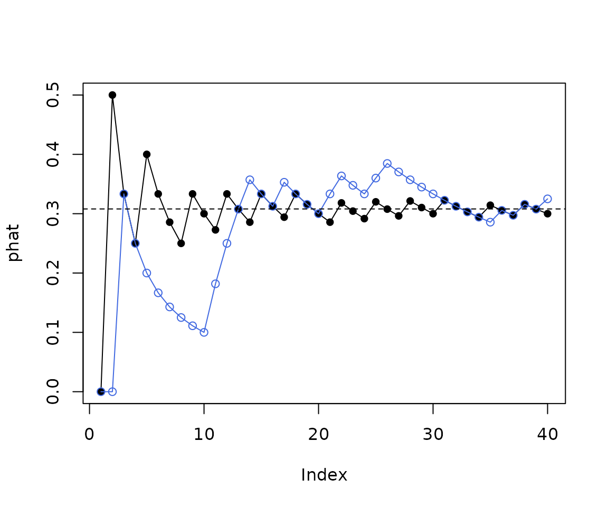

# Miscellaneous Examples

``` r

library(lpsugar)
library(ROI.plugin.highs)
```

## Browser Problem

Imagine we’re the developers of a browser called Ours, and we want to
prove that it’s better than other any other browser, based on a set of
features.

``` r

browsers <- c("Ours", "Chrome", "Firefox", "Opera", "Safari")
features <- c("Speed", "Ease of use", "Customizability", 
              "Privacy", "Extensions", "Ad-blocker")
```

For each feature \\i\\, each browser \\b\\ will have a rating
\\R\_{ib}\\. (These are made up)

``` r

ratings
#>                  browsers
#> features          Ours Chrome Firefox Opera Safari
#>   Speed              9      7       7     1     10
#>   Ease of use        2      7      10     5      5
#>   Customizability    6      2       9     5      9
#>   Privacy            1      7       2    10      6
#>   Extensions         9      7       3     4      1
#>   Ad-blocker         5      5       7     3      3
```

The question is how important is each feature? Let’s give each feature
\\i\\ an optimal weight \\w_i\\. Then, we can calculate a
\\\text{Score}\_b(w)\\ for each browser \\b\\.

\\ \text{Score }\_b = \sum\_{i\in\text{Features}}{w_i R\_{ib}} \qquad
\forall b\in\text{Browsers} \\

Let’s try giving all the features the same weight. \\w_i=1 \quad \forall
i \in \text{Features}\\. We get these scores:

``` r

scores <- colSums(ratings)
sort(scores, decreasing = TRUE)
#> Firefox  Chrome  Safari    Ours   Opera 
#>      38      35      34      32      28
```

But this is nonsense! This would mean Ours is one of the worst browsers!

Let’s fix this. We’ll bias the weights \\w\\ in favor of Ours. We can do
this by maximizing the difference in scores between Ours (which will
have the highest score) and the second best score.

\\ \max_w \\\\ \text{Score}\_\text{ Ours}(w) - \text{Second Best Score
}(w) \\ \\ \\

We’ll make sure each feature *matters* by having \\1 \le w_i \le 5\\,
and make them integers for simplicity.

``` r

browser_problem <- lp_problem() |> 
    lp_variable(weight[features], lower = 1, upper = 5, integer = TRUE) |> 
    lp_variable(score[browsers]) |> 
    lp_variable(second_best_score) |>
    lp_maximize(score["Ours"] - second_best_score) |> 
    lp_subject_to(
        for (b in browsers) {
            score[b] == sum_over(ratings[i, b] * weight[i], i=features)
        },
        for (b in browsers) if (b != "Ours") {
            second_best_score >= score[b]
        }
    ) |> 
    lp_solve(solver = "highs")

optimal_weights <- browser_problem$variables$weight
```

Take a look at the new weights. Now speed and extensions are the most
important features, and customizability is also relevant.

    #>           feature weight
    #> 1           Speed      5
    #> 2     Ease of use      1
    #> 3 Customizability      3
    #> 4         Privacy      1
    #> 5      Extensions      5
    #> 6      Ad-blocker      1

With these new weights, we can calculate the new scores for each
browser. These prove that Ours is the best browser!

``` r

new_scores <- numeric()
for (b in browsers) 
    new_scores[b] <- sum_over(ratings[i, b] * optimal_weights[i], i=features)

sort(new_scores, decreasing = TRUE)
#>    Ours Firefox  Safari  Chrome   Opera 
#>     116      96      96      95      58
```

## Not-So-Random Number Generator (NSRNG)

We want to generate a sequence of values according to a probability
distribution.

\\ y_t \sim \text{Bernoulli}(p = 0.308) \qquad t \in \[1,n\] \\

But we will do it in a not-so-random way. Let \\y\_{1:k}\\ denote the
subsequence \\\\y_t\\\_{t \in \[1,k\]}\\. For each of these
subsequences, we will minimize the absolute difference between the real
probability \\p\\ and the estimated probability \\\hat{p}\_k\\

\\ \min_y \sum\_{k=1}^n{\|p - \hat{p}\_k\|} \\ \\ \hat{p}\_k =
\frac{1}{k}\sum\_{t=1}^k{y_t} \\

``` r

n = 40
p = 0.308

nsrng <- lp_problem() |> 
    lp_var(y[1:n], binary = TRUE) |> 
    lp_alias(phat = cumsum(y) / (1:n)) |> 
    lp_var(err[1:n]) |> 
    lp_con(err >= abs(phat - p)) |> 
    lp_min(sum(err)) |> 
    lp_solve(solver = "highs")

phat <- nsrng$aliases$phat
```

See how quickly \\\hat{p}\\ converges to the true probability \\p\\.

``` r

plot(phat, pch = 16)
lines(1:n, phat)
abline(h = p, lty = 2)
```


For reference, in blue you can see how a random sequence would converge.

``` r

set.seed(101)
rng <- rbinom(n, size = 1, prob = p)
phat_rng <- cumsum(rng) / (1:n)

plot(phat, pch = 16)
lines(1:n, phat)
points(1:n, phat_rng, col = "royalblue")
lines(1:n, phat_rng, col = "royalblue")
abline(h = p, lty = 2)
```


